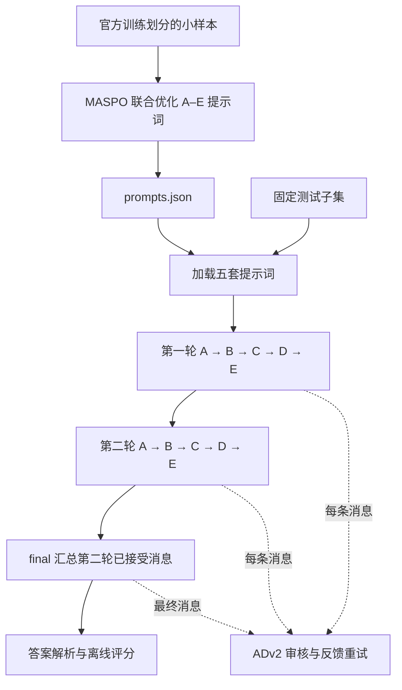

# LycheeMAS 适配与信息流

本仓库保留 LycheeMAS 的 `AgentSpec`、`GraphView`、注册器、MASPO 优化器和 ADv2 运行时控制器，在其上增加一个可运行的课程实验层。入口为 `lychee-course`，也可执行 `python scripts/run_course.py`。

## 原框架提供什么

LycheeMAS v0.3 提供五类接缝：构建 `build_langgraph`、运行前优化 `optimize_langgraph`、记忆 `attach_memory`、执行 `run_processed`、运行后分析与训练。`plugins/` 保存协议与分发，`methods/` 保存算法。

节点以 `metadata={"agent_spec": spec}` 挂到 StateGraph；`spec.system_prompt` 保存提示词，`spec.meta["predecessors"]` 描述通信来源。`GraphView` 提取和写回这个契约。执行边决定节点调度顺序，通信前驱决定节点可见信息，二者可以不同。

在本次检查的上游快照中，`attach_memory` 的节点注入入口和部分运行后归因、信用分配、训练组件仍是抛出 `NotImplementedError` 的占位实现。课程实验直接管理每题内部的两轮状态，不依赖这些占位组件。

## 本次模块

| 模块 | 内容 |
|---|---|
| `course/workflow.py` | 五 Agent、两轮展开图；共享提示词；已接受消息过滤；受限算术工具；可选 StateGraph 执行 |
| `course/cli.py` | 训练和测试抽样、MASPO 优化、提示词产物加载、并发执行、恢复与完整分母汇总 |
| `course/io.py` | OpenAI 兼容 HTTP 请求、非思考参数、模型调用记录、用量统计 |
| `course/data.py` | 数据格式转换、划分检查、固定抽样、选择题与数学评分 |
| `methods/prerun/maspo/` | 多粒度比较、提示词搜索、缓存与共享角色适配 |
| `methods/runtime/agentdropout_v2.py` | 固定指标选择、审核、反馈重生成、拒绝 |

模块路径以 `src/lychee_mas/` 为起点。上游来源和复用范围见仓库的来源说明。

## 优化与推理

MASPO 不更新模型权重。它通过同一模型生成候选提示词，再比较候选与当前提示词产生的本地输出、下游输出与最终答案。优化调用 `CourseExecutor`；正式执行也调用这个执行器，并启用 ADv2。`A` 与 `A_r2` 等两个节点通过 `prompt_source` 使用同一角色提示词，优化候选不会只影响第一轮。

优化期不启用 ADv2，测试期对十条角色消息和 final 消息审核。最大重试数指初稿之后允许的重生成次数，`--max-retries 1` 最多产生两版。固定三个指标分别检查任务条件、推理有效性、答案与推导的一致性。使用全局固定指标时，全部指标参与审核。

## 五 Agent 与两轮通信

| 节点 | 角色 | 同轮可见 | 第二轮另可见的上一轮消息 |
|---|---|---|---|
| A | 求解者 | 无 | A |
| B | 分析者 | A | A、B |
| C | 程序化核验者 | A、B | A、B、C |
| D | 检查者 | A、B、C | A、B、C、D |
| E | 求解者 | A、B、C、D | A、B、C、D、E |

以上范围都只包含通过审计的最终版本。同一轮为 `j < i`，跨轮为上一轮的 `j <= i`。拒绝一条消息不会删除角色，下一轮该角色仍可执行。final 只读取第二轮已接受的消息。

例如第一轮 B 经过反馈修正才通过，下游收到修正版；若重试后仍被拒绝，第一轮 C/D/E 和第二轮 B/C/D/E 的上下文都省略 B 的消息。第二轮 A 不会读取上一轮 D 的检查意见。

本课程实现中所有角色接收完整可见消息。数学任务的 C 生成赋值式 Python，由 AST 算术解释器实际求值；可使用算术运算与少量数值函数，不支持 import、属性访问、任意函数定义、循环和文件访问。选择题的 C 改为比较各选项证据。

## StateGraph 与 GraphView

`--engine langgraph` 将展开后的十个角色节点及 final 注册为 StateGraph，节点 metadata 保留 `AgentSpec`，执行 `compile().ainvoke()`。运行仍从 `predecessors` 读取允许通信的节点输出。

`--engine graphview` 直接依拓扑序调用同一节点函数，适合轻量运行与接口测试。两种载体共用上下文构造、角色提示词、审核器与结果缓存。

## 两处关键实现处理

1. **优化与执行保持同一流程。** MASPO 注入 `executor_factory=CourseExecutor`，只优化 A–E 五个角色。改变角色提示词时重跑受影响节点和所有后继，包括第二轮对应角色。final 提示词固定。
2. **拒绝草稿不参与传播。** 正常缓存仅保存审核通过的内容；`visible_sources`、跨轮输入和 final 都从正常缓存读取。初稿、失败重试与反馈单独保存在审计字段中，不转换成默认数字 0。

模型服务调用失败或 final 被拒绝时保留该题的结果记录，准确率仍按全部测试题计算。问题的标准答案用于离线评分，不进入角色或 ADv2 审核提示词。

提示词提议与角色生成使用独立输出预算。MATH 首次优化的提议在 1536 token 处截断后，以 3072 token 在新目录完成优化；角色生成在优化阶段为 1024 token。最终测试在新目录统一使用 2048 token，加载已完成的五套提示词。其余数据集的角色生成仍为 1024 token，提议为 1536 token。

客户端保留所有返回的响应及原始 `finish_reason`。真正不完整的文本或 JSON 最多追加两次格式重试；完整闭合的 JSON 即使以 `length` 结束仍可接受，未闭合 JSON 不能接受。格式重试只附加简短、去重或 JSON 闭合要求，不加入标准答案，也不增大 token 预算。恢复运行只处理错误题；同 ID 换题、换答案或换提示词时拒绝复用原输出目录。
